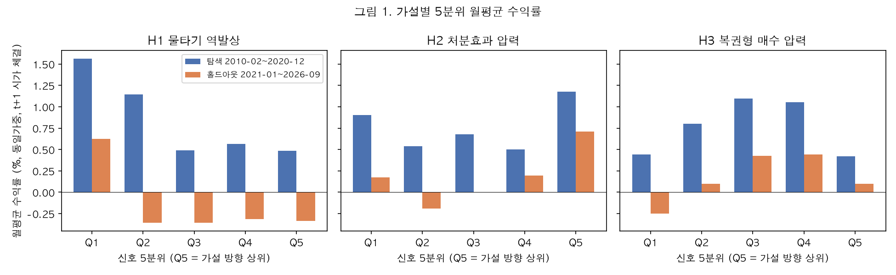
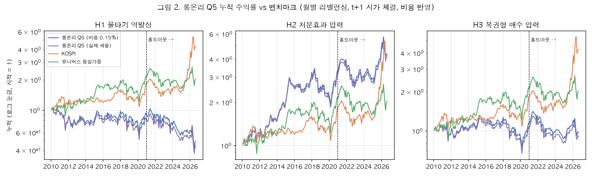
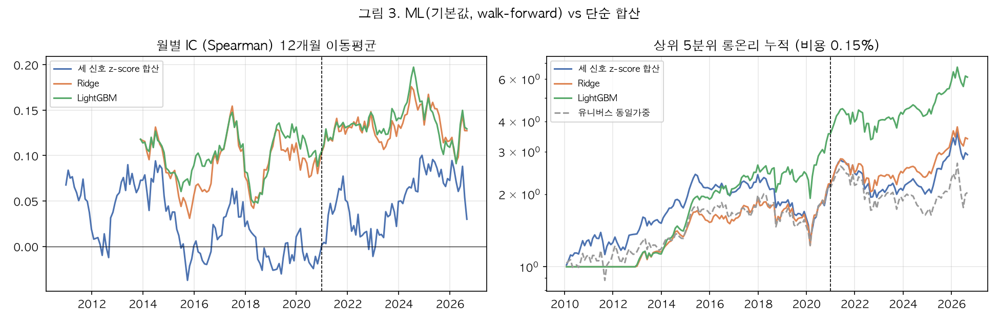
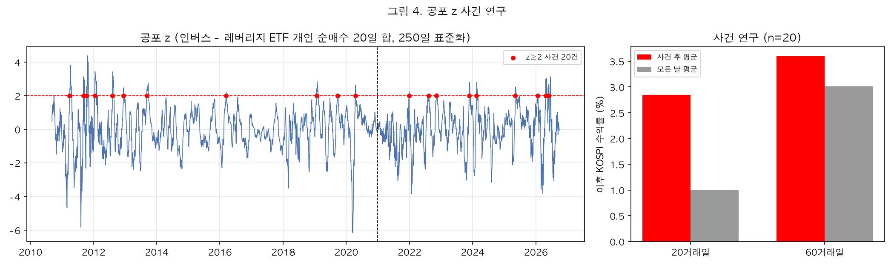

# retail-bias-factor — 개인투자자 행동 편향의 흔적으로 만든 역발상 팩터

> 개인투자자의 행동 편향(물타기·처분효과·복권형 선호·공포)이 가격에 남긴 흔적을 KRX 공개 데이터로 **종목별로 측정**해, 역발상 팩터로 쓸 수 있는지 **사전등록한 절차**(가설 4개 고정, 윈도우 하나, 격자 탐색 금지, 홀드아웃 1회)로 검증했다. 결과: **세 가설 모두 기각, 공포 오버레이 지지되지 않음.** 대신 데이터는 반대 방향을 말했다 — 급락 종목을 개인이 순매수하면 다음 달 수익률이 **높았다**(탐색 t 4.5, 홀드아웃 t 2.0).

투자 조언이 아니다. 종목·시점·수익률에 관한 어떤 주장도 하지 않으며, 그런 어휘는 테스트(`tests/test_vocab_gate.py`)가 막는다. 데이터는 전부 공개 데이터(KRX)다.

**왜 이 주제인가.** 내가 만든 앱 복희는 한 사람의 매매 기록에서 처분효과·손실 후 재매수·복권형 선호를 잰다. 이 프로젝트는 같은 편향을 시장 전체에서 잰다. *복희는 한 사람의 편향을, 이 프로젝트는 시장의 편향을 쟀고, 시장은 다르게 답했다.*

---

## 결과 한눈에

| 가설 | 검정 (Fama–MacBeth, 통제 5개, Newey–West) | 탐색 2010-02~2020-12 (131개월) | 홀드아웃 2021-01~2026-09 (69개월) | 판정 |
|---|---|---|---|---|
| **H1 물타기 역발상** — 급락 종목 중 개인 순매수가 강한 종목은 이후 수익률이 낮다 | 급락 집합 안 RNB5 계수 < 0 | 계수 **+0.0046, t +4.51** (부호 반대) | +0.0031, t +2.02 | **기각** |
| **H2 처분효과 압력** — 미실현 이익(CGO)이 큰 종목은 이후 수익률이 높다 | CGO260 계수 > 0 | +0.0008, t +0.64 | +0.0010, t +0.43 | **기각** |
| **H3 복권형 매수 압력** — MAX 크고 개인 순매수 강한 종목은 이후 수익률이 낮다 | MAX20 × RNB5 계수 < 0 | +0.0013, t +1.82 (부호 반대) | +0.0013, t +0.77 | **기각** |
| **H5 공포 오버레이** — 개인의 인버스 ETF 순매수가 극단일 때 이후 KOSPI 가 높다 | z≥2 사건 후 20·60일 KOSPI | 사건 20건, 20일 후 +2.85% vs 평소 +0.99% (t 1.41) | 오버레이 −0.24%p/월 (t −1.02) | 지지되지 않음 |

판정 기준(사전등록): 탐색 |t| ≥ 2.0 이고 가설 부호, 그리고 홀드아웃 부호 일치 → 지지 / 홀드아웃에서 뒤집힘 → 불안정 / 탐색 실패 → 기각. 홀드아웃은 **1회** 실행했고 실행 기록은 `results/holdout_runs.jsonl` 에 있다.



*그림 1. 신호 5분위별 월평균 수익률(동일가중, t+1 시가 체결). Q5 가 가설 방향 상위. H1 은 Q1(개인 순매수 최강)이 가장 높아 가설과 반대, H2 는 단조성이 없고, H3 는 양 끝이 모두 낮다.*



*그림 2. 롱온리 Q5(비용 0.15% / 실제 세율) vs KOSPI·유니버스 동일가중. 점선 오른쪽이 홀드아웃. 세 가설 모두 비용 후 유니버스 동일가중을 넘지 못한다(탐색: H1 −0.56%p/월, H2 +0.29%p t 1.34, H3 −0.53%p).*

### 뜻밖의 발견 (사후 관찰 — 가설이 아니다)

개인 순매수 강도(RNB5)의 **양(+)** 효과는 모든 소구간(연도, KOSPI/KOSDAQ, 대·소형, 2015-06 가격제한폭 확대 전후, 심리 국면)에서 같은 방향이고, 플라시보(외국인 순매수)는 **반대** 부호다. 1개월 시계에서는 개인이 "물타기로 손해 보는 투자자"가 아니라 가격이 밀릴 때 사고 반등을 먹는 **단기 유동성 공급자**로 보인다. 사전등록에 없는 발견이므로 팩터로 쓰지 않았고, 다음 사전등록의 후보로만 적었다(`docs/08_limitations.md`).

### ML 결합 — 합산을 이겼지만, 이긴 이유가 중요하다



*그림 3. Ridge·LightGBM(기본값, walk-forward 확장 창, 연 1회 재학습) vs 세 신호 z-score 합산. IC(월별 Spearman) 탐색 0.09~0.10 vs 0.02, 홀드아웃 0.13~0.14 vs 0.05.*

LightGBM 상위 5분위는 비용 후 유니버스 대비 +0.65%p/월(탐색, t 4.1), +0.83%p(홀드아웃, t 3.3)를 냈다. 그러나 특징 중요도(`results/stage3/ml_importance_summary.csv`)는 **회전율(−, gain 25%)**, 모멘텀, MAX(−), 개인 거래 비중(−), 시가총액(−), 그리고 **가설과 반대 부호의 개인 순매수(+)** 가 차지한다. 즉 사전등록한 세 팩터의 결합이 성공한 것이 아니라, 통제 변수와 반대 방향 신호를 모델이 배운 것이다. 이것을 상품으로 가져가려면 새 사전등록과 새 홀드아웃이 필요하다.



*그림 4. 공포 z(인버스 − 레버리지 ETF 개인 순매수 20일 합, 250일 표준화)와 z≥2 사건 20건의 사건 연구. 차이는 통계적으로 약하다.*

---

## 설계 — 결과보다 과정이 산출물이다

```mermaid
flowchart LR
  A["KRX 스냅샷 수집<br/>시세·투자자별 순매수·시가총액·ETF<br/>2009-01~2026-10, 4,382 거래일"] --> B["가공 parquet<br/>행=날짜 열=티커"]
  B --> C["지표 (일별)<br/>RNB5 · RSH20 · 급락 · CGO260 · MAX20<br/>심리 국면 · 공포 z · 통제 5개"]
  C --> D["유니버스 (월말)<br/>보통주 → 스팩 제외 → 거래정지 제외<br/>→ t+1 체결 가능 → 시총·거래대금 하위 20% 제외"]
  D --> E["보유 수익률<br/>t+1 시가 → t'+1 시가<br/>상장폐지는 마지막 종가 청산"]
  E --> F["검정<br/>5분위 EW·VW · Fama–MacBeth NW<br/>소구간 · 플라시보 · 비용 4안 · MDE"]
  F --> G["탐색 2010-02~2020-12"]
  G -->|사전등록 잠금 커밋| H["홀드아웃 1회<br/>2021-01~2026-09"]
  H --> I["ML walk-forward · 공포 오버레이"]
  I --> J["리포트 · 그림 · 상품안 · 한계"]
```



| 규칙 | 구현 | 강제 수단 |
|---|---|---|
| 룩어헤드 차단 | 투자자별 데이터는 장 마감 후 공표 → t 종가까지로 신호, **t+1 시가 체결**. 수익률은 같은 날 시가/종가 비율과 KRX 등락률만 써서 배당락·분할일에도 맞음 | `tests/test_lookahead.py`: asof 이후를 잘라낸 입력으로 계산해도 값이 같아야 통과 |
| 생존 편향 제거 | 날짜별 전 종목 스냅샷 → 그날 상장된 종목이 유니버스. 상장폐지 종목 포함, 마지막 종가로 청산 | 2015-01-02 스냅샷에 한진해운·구 삼성물산 존재 확인 |
| 사전등록 | 가설 4개·윈도우 하나·판정 기준을 결과 전에 고정. 탐색 결과를 본 뒤 코드·파라미터 불변 | `docs/03_preregistration.md` 의 잠금 커밋 해시 |
| 홀드아웃 1회 | 실행기가 잠금 커밋을 확인하고 실행마다 기록 | `results/holdout_runs.jsonl`, `tests/test_holdout_counter.py` |
| 비용·수용 규모 | 편도 0.15% 기본, 0.10%·0.25%, **연도별 실제 증권거래세** 시나리오, 월 회전율, 참여율 10% 기준 수용 규모 | `results/*/*_longonly.csv`, `results/stage3/capacity_score_q5.csv` |
| 어휘 게이트 | 수익률 방향을 단정하는 다섯 낱말이 코드·문서·결과에 나오면 실패 | `tests/test_vocab_gate.py` |
| 데이터 검증 | 파일 누락 0, 종목 수 급변 0, 등락률·종가비율 불일치 0.055%(기준가 조정일), 시가총액 항등식 | `results/data_validation.md` |

---

## 문서 안내

| 파일 | 내용 |
|---|---|
| [`docs/00_stage0_data_check.md`](docs/00_stage0_data_check.md) | 0단계 데이터 가용성 실측(분모 포함)과 결정 사항 |
| [`docs/01_research.md`](docs/01_research.md) | 근거 문헌 3편 요약(KCMI 22-02, Grinblatt–Han 2005, Byun·Jeon·Kim 2023)과 우리 설정과의 차이 |
| [`docs/02_design.md`](docs/02_design.md) | 설계 결정 로그 D1~D25 — 무엇·왜·되돌리면 |
| [`docs/03_preregistration.md`](docs/03_preregistration.md) | 사전등록 문서(가설·지표·판정 기준·보고 항목·잠금 커밋) |
| [`docs/04_stage1_report.md`](docs/04_stage1_report.md) | 1단계 탐색 결과 보고(한 일 / 숫자 / 해석) |
| [`docs/05_product.md`](docs/05_product.md) | 액티브 ETF 상품안 1쪽 — 결론: 현재 결과로는 근거 없음, 수용 규모 수백억 원 |
| [`docs/06_interview.md`](docs/06_interview.md) | 예상 질문과 답(방법론·결과) |
| [`docs/08_limitations.md`](docs/08_limitations.md) | 정직하게 적어야 할 것 — 한계와 사후 관찰 |
| [`results/stage1/summary.md`](results/stage1/summary.md) · [`results/stage2/summary.md`](results/stage2/summary.md) | 탐색·홀드아웃 전체 표(5분위, FM, 비용별 롱온리, 소구간, MDE) |
| [`results/stage3/ml_summary.md`](results/stage3/ml_summary.md) · [`results/stage3/overlay_summary.md`](results/stage3/overlay_summary.md) | ML 비교, 공포 z 사건 연구·오버레이 |
| `results/report.html` | 표 35개·그림 4장을 한 쪽에 모은 리포트(내려받아 열기) |

## 숫자로 보는 저장소

| | |
|---|---|
| 데이터 | KOSPI+KOSDAQ 전 종목 스냅샷 4,382 거래일(2009-01-02~2026-10-14) × 시세·시가총액·개인/외국인/기관 순매수, 레버리지·인버스 ETF 6종, KRX 호출 약 25,000건 |
| 유니버스 | 월평균 1,284종목(탐색) · 1,649종목(홀드아웃), 제외 단계 8개 건수 월별 기록 |
| 검정 | 리밸런싱 131 + 69회, Fama–MacBeth 회귀 사양 15개, 소구간 21개 × 3, 플라시보 2, 비용 시나리오 4 |
| 코드 | `src/rbf` 8개 모듈, 스크립트 11개, 테스트 12개(룩어헤드·분모·유니버스·청산·어휘·홀드아웃 기록) |

---

## 재현

```bash
python3.12 -m venv .venv && .venv/bin/pip install -r requirements.txt && .venv/bin/pip install -e .
cp .env.example .env            # KRX 정보데이터시스템 ID/PW. 캐시가 있으면 로그인 불필요
scripts/run_all.sh              # 수집 → 가공 → 테스트 → 1단계 → (잠금 후) 홀드아웃 → 3단계 → 그림·리포트
```

| 단계 | 명령 | 산출물 |
|---|---|---|
| 수집 | `scripts/collect_krx.py`, `scripts/collect_admin_issue.py` (순차 실행 `scripts/run_collection_chain.sh`) | `data/raw/` |
| 가공 | `python -m rbf.io_raw` | `data/processed/{연도}/{변수}.parquet` |
| 검증 | `scripts/validate_data.py`, `pytest` | `results/data_validation.md` |
| 1단계 탐색 | `scripts/run_stage1.py` | `results/stage1/` |
| 2단계 홀드아웃 | `scripts/run_holdout.py --note ...` (잠금 후 1회) | `results/stage2/` + 판정 |
| 3단계 | `scripts/run_stage3_ml.py`, `scripts/run_stage3_overlay.py` | `results/stage3/` |
| 4단계 | `scripts/make_figures.py`, `scripts/make_report.py` | `figures/`, `results/report.html` |

코드는 `src/rbf/`: `config`(상수) · `io_raw`(원천→parquet) · `signals`(지표) · `returns`(t+1 시가 체결 보유 수익률) · `universe`(제외 규칙·관리종목 복원) · `fm`(윈저라이즈·Fama–MacBeth·MDE) · `portfolio`(5분위·비용) · `analysis`(가설별 검정).

## 데이터 출처와 KRX 이용약관 (중요)

원천 데이터는 KRX 정보데이터시스템(data.krx.co.kr)에서 pykrx 로 받았다. 수집 중 KRX 가 "자동화 수단을 통한 비정상 대량 조회"를 이유로 IP 를 1일 제한했고, 안내문은 이용약관 제10조 제2호가 자동화 수단을 이용한 정보 수집을 금지한다고 밝혔다. 따라서 **이 저장소의 수집 스크립트를 대량으로 실행하는 것을 권하지 않는다.** 재현에는 가공 캐시를 쓰거나 KRX 가 안내한 공식 경로(화면 다운로드, 데이터 상품, [KRX Open API](https://openapi.krx.co.kr))를 쓴다. 관리종목 이력은 이 제한으로 받지 못해 유니버스에 적용하지 못했다(설계 D25; 최신 시점 관리종목 180개 중 172개는 다른 규칙으로 이미 제외).

### 캐시 구조 (`data/raw/`, `data/processed/` — git 제외)

| 경로 | 내용 | 출처 |
|---|---|---|
| `index/kospi_1001_{YYYY}.csv` | KOSPI 지수 일별 OHLCV, 거래일 달력 겸용 | `get_index_ohlcv_by_date` |
| `ohlcv/{YYYY}/{YYYYMMDD}_{KOSPI\|KOSDAQ}.csv` | 그날 상장된 전 종목 시가·고가·저가·종가·거래량·거래대금·등락률·시가총액 | `get_market_ohlcv_by_ticker` [12001] |
| `netbuy/{YYYY}/{YYYYMMDD}_ALL_{indiv\|foreign\|inst}.csv` | 종목별 개인·외국인·기관합계 매도·매수·순매수 | `get_market_net_purchases_of_equities` [12010] |
| `cap/{YYYY}/{YYYYMMDD}_ALL.csv` | 종목별 시가총액·상장주식수 | `get_market_cap_by_ticker` |
| `etf/{ticker}_{YYYY}.csv` | ETF 투자자별 일자별 순매수 거래대금 | `get_etf_trading_volume_and_value` |
| `admin/` | 관리종목 지정·해제 이벤트(일부만 수집) | KRX [20013] `MDCSTAT21501` |

### 데이터의 함정과 처리 (실측으로 생긴 규칙)

| 함정 | 처리 |
|---|---|
| `market="ALL"` 은 KONEX 를 포함 | KOSPI·KOSDAQ 스냅샷의 티커 집합으로 거른다 |
| 거래정지일은 시가=고가=저가=0, 거래량=0, 등락률=0 | 거래정지 플래그로 쓰고 그날은 유니버스에서 뺀다(체결 없는 날 포함) |
| [12010] 은 그날 그 투자자가 거래한 종목만 돌려준다 | 없는 종목은 거래 0 으로 본다(결측 아님) |
| 우선주는 이름 규칙으로 놓치는 것이 있다(전환우선주 `K`/`L` 접미) | 티커 끝자리 ≠ `0` 이면 우선주 |
| 주식분할·배당락 날 가격 불연속 | 수익률은 KRX `등락률`(기준가 조정 반영)로 만들고, 수정 가격은 그 누적으로 만든다 |
| t+1 시가가 상·하한가에 잠긴 종목은 살 수 없다 | 시가=고가=저가=종가인 날은 그 달 유니버스에서 뺀다 |
| KRX 로그인 세션 1시간 만료 | pykrx 가 자동 재로그인. 받은 CSV 를 캐시 |

## 저장소 구조

```
src/rbf/        지표·수익률·유니버스·통계·검정 모듈
scripts/        수집·가공·검증·단계별 실행·그림·리포트
tests/          룩어헤드·분모·유니버스·청산·어휘 게이트·홀드아웃 기록
docs/           리서치 요약 · 설계 결정 로그 · 사전등록 · 단계 보고 · 상품안 · 면접 메모 · 한계
results/        stage1(탐색) · stage2(홀드아웃) · stage3(ML·오버레이) · report.html · data_validation.md
figures/        그림 4장
data/probe/     0단계 실측 스냅샷(소형, 포함) — data/raw·processed 는 git 제외
```

## 라이선스

MIT
